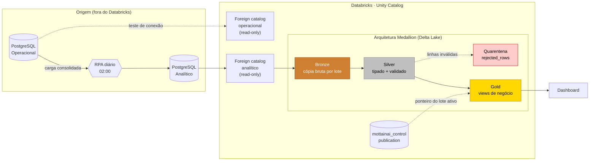
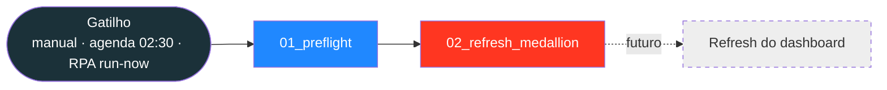
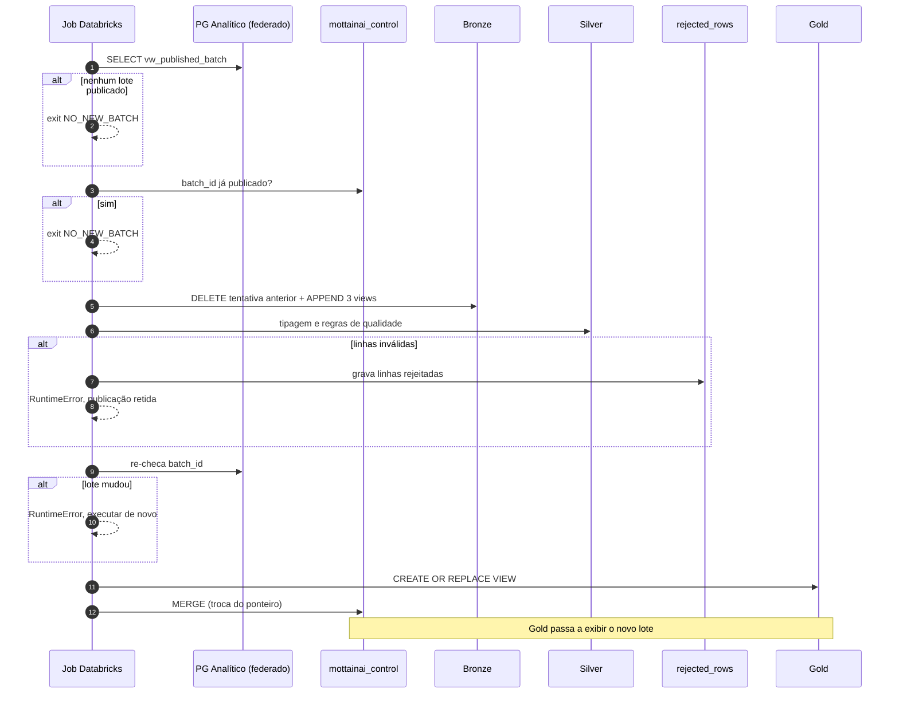
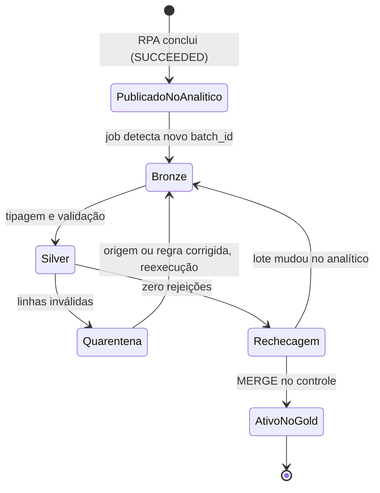
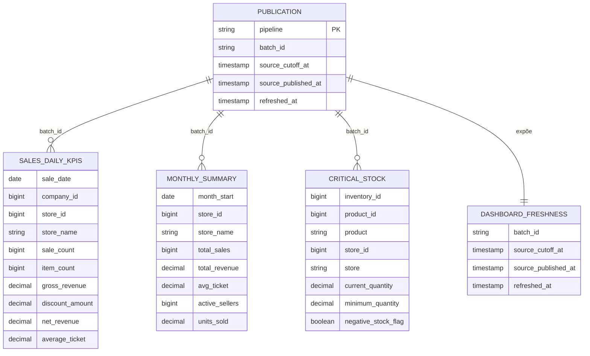
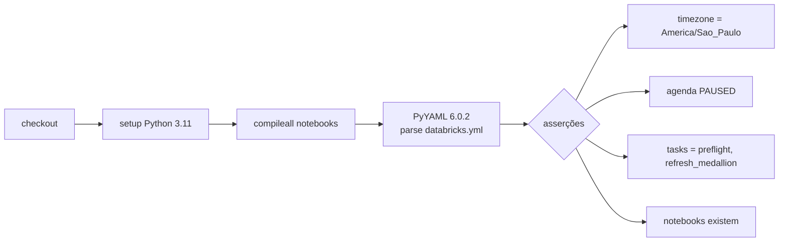

<div align="center">

# Mottainai BI

**Camada de Business Intelligence do Mottainai: gestão preditiva de estoque para pequenos e médios varejos**

*Do PostgreSQL analítico ao dashboard, passando por uma arquitetura Medallion no Databricks Lakehouse, com idempotência, quarentena de dados e publicação atômica.*

<br/>

[](https://www.databricks.com/)
[](https://spark.apache.org/)
[](https://delta.io/)
[](https://www.postgresql.org/)

[](https://www.python.org/)
[](https://www.databricks.com/product/unity-catalog)
[](https://docs.databricks.com/en/dev-tools/bundles/index.html)
[](.github/workflows/ci.yml)
[](databricks.yml)
[](#status-do-projeto)
[](https://github.com/Mottainai-One/Mottainai-BI/pull/3)

<br/>

[Visão geral](#visão-geral) •
[Arquitetura](#arquitetura) •
[Tecnologias](#tecnologias) •
[Pipeline](#como-o-pipeline-funciona) •
[Datasets](#datasets) •
[Como implantar](#como-implantar) •
[Operação](#operação-e-monitoramento) •
[Segurança](#segurança) •
[Trabalho em andamento](#trabalho-em-andamento-fora-da-main) •
[Riscos](#limitações-e-riscos) •
[Referências](#referências)

</div>

---

> [!IMPORTANT]
> Este README descreve a branch padrão **`main` @ `4b7b6e0`**. A [PR #3](https://github.com/Mottainai-One/Mottainai-BI/pull/3) (`feature/bronze-remote-query`, aberta) muda bastante o projeto: leitura via `remote_query`, task Bronze separada, dashboard versionado, agenda ativa e outros datasets Gold. Veja [Trabalho em andamento](#trabalho-em-andamento-fora-da-main) antes de implantar.

---

## Visão geral

O **Mottainai** (もったいない, expressão japonesa para *"que desperdício"*) é um sistema inteligente de gestão preditiva de estoque. Este repositório versiona a **camada de BI**: transforma os dados já consolidados no PostgreSQL analítico em tabelas confiáveis e prontas para dashboards.

| | Princípio | Como é garantido |
|---|---|---|
| **1** | **Somente leitura nas fontes** | Os dois PostgreSQL são acessados via *foreign catalogs* do Unity Catalog. O operacional é usado **apenas** para teste de conexão. |
| **2** | **Nada de dado pela metade** | O job lê o lote exposto por `vw_published_batch`. A view oficial sobre `job_log` seleciona registros `SUCCEEDED` do contrato analítico. |
| **3** | **Idempotência** | O `batch_id` (UUID) é a chave de replay. Rodar o job duas vezes não duplica nada. |
| **4** | **Qualidade antes de publicar** | Linhas inválidas vão para quarentena (`rejected_rows`) e **bloqueiam** a publicação do lote. |
| **5** | **Troca atômica** | Gold só "enxerga" o novo lote quando o ponteiro de controle é atualizado, no fim de todas as etapas. |
| **6** | **Dashboard isolado** | O dashboard consulta **somente Gold**, nunca o operacional nem os catálogos federados. |

---

## Arquitetura

### Fluxo de dados ponta a ponta



### Camadas e schemas

Todos os schemas são criados pelo preflight dentro do catálogo gerenciado definido em `target_catalog` (padrão: `workspace`).

| Camada | Schema | Tipo de objeto | Responsabilidade |
|:---:|---|---|---|
|  | `mottainai_bronze` | Tabelas Delta | Cópia fiel das views analíticas, com `_batch_id`, `_source_published_at` e `_ingested_at` |
|  | `mottainai_silver` | Tabelas Delta | Tipagem, `trim`, `coalesce`, checagem de chaves duplicadas e regras de qualidade |
|  | `mottainai_silver.rejected_rows` | Tabela Delta | Linhas rejeitadas, com `error_code` e a linha original em JSON |
|  | `mottainai_gold` | Views | Projeção de negócio filtrada pelo lote publicado |
|  | `mottainai_control` | Tabela Delta | Ponteiro do lote ativo por pipeline |

---

## Tecnologias

<table>
<tr>
<td align="center" width="140"><br/><b>Databricks</b><br/><sub>Plataforma Lakehouse<br/>(Free Edition)</sub></td>
<td align="center" width="140"><br/><b>PySpark</b><br/><sub>Transformações<br/>e Spark SQL</sub></td>
<td align="center" width="140"><br/><b>Delta Lake</b><br/><sub>Armazenamento ACID,<br/><code>MERGE</code> e <code>DELETE</code></sub></td>
<td align="center" width="140"><br/><b>PostgreSQL</b><br/><sub>Fontes operacional<br/>e analítica</sub></td>
</tr>
<tr>
<td align="center" width="140"><br/><b>Python 3.11</b><br/><sub>Notebooks<br/>Databricks</sub></td>
<td align="center" width="140"><br/><b>GitHub Actions</b><br/><sub>CI de validação<br/>do bundle</sub></td>
<td align="center" width="140"><br/><b>YAML + PyYAML</b><br/><sub>Infra como código<br/>(<code>databricks.yml</code>)</sub></td>
<td align="center" width="140"><br/><b>Git</b><br/><sub>Versionamento<br/>da camada BI</sub></td>
</tr>
</table>

### Recursos do Databricks utilizados

| Recurso | Uso no projeto |
|---|---|
| **Unity Catalog** | Governança, catálogos, schemas e permissões |
| **Lakehouse Federation** (*foreign catalogs*) | Leitura somente leitura dos dois PostgreSQL, sem credenciais no Git |
| **Databricks Asset Bundles** | Definição declarativa do job, variáveis e agenda em `databricks.yml` |
| **Databricks Workflows (Jobs)** | Orquestração `preflight → refresh_medallion`, com `max_concurrent_runs: 1` |
| **Quartz Cron** | Agenda de contingência `0 30 2 * * ?` em `America/Sao_Paulo` |
| **Notebook widgets** | Parametrização dos catálogos em tempo de execução |
| **Databricks CLI** | `bundle validate`, `bundle deploy` e `bundle run` |

---

## Estrutura do repositório

```text
Mottainai-BI/
├── .github/
│   └── workflows/
│       └── ci.yml                    # Compila notebooks e valida o bundle
├── docs/
│   └── RUNBOOK.md                    # Operação, consultas de verificação e gatilhos
├── notebooks/
│   ├── 01_preflight.py               # Valida conexões e cria schemas e a tabela de controle
│   └── 02_refresh_medallion.py       # Bronze → Silver → Gold, com quarentena e publicação
├── databricks.yml                    # Databricks Asset Bundle (job, variáveis e agenda)
├── .gitignore
└── README.md
```

---

## Como o pipeline funciona

### Orquestração do job



<details>
<summary><b>01_preflight.py: o que é validado</b></summary>

<br/>

1. Valida os três identificadores de catálogo com regex (`[A-Za-z_][A-Za-z0-9_]*`), uma proteção contra injeção de SQL.
2. Garante que o catálogo operacional e o analítico são **distintos**.
3. Garante que o `target_catalog` **não** é um catálogo estrangeiro.
4. Testa a conexão operacional com `count(*)` em `mottainai.company`, sem copiar dados.
5. Verifica que `vw_published_batch` expõe **no máximo um** lote atual.
6. Testa o contrato das três views de origem com `SELECT * ... LIMIT 0`.
7. Cria os schemas `mottainai_bronze`, `mottainai_silver`, `mottainai_gold` e `mottainai_control`.
8. Cria a tabela Delta `mottainai_control.publication`.

</details>

<details>
<summary><b>02_refresh_medallion.py: etapas do refresh</b></summary>

<br/>

1. Lê o lote publicado. Se não houver, encerra com `NO_NEW_BATCH`, mantendo o dashboard atual intacto.
2. Normaliza o `batch_id` como UUID, o que também impede injeção no `DELETE`.
3. Se o lote já está no controle, encerra com `NO_NEW_BATCH`, sem reprocessar.
4. **Bronze:** apaga tentativas anteriores do mesmo lote e faz `append` das três views com metadados de ingestão.
5. **Silver:** tipa, normaliza e checa chaves duplicadas. Se houver duplicidade, o job falha.
6. **Quarentena:** linhas que violam as regras vão para `rejected_rows` e a publicação é **retida**.
7. **Re-checagem:** confirma que o lote publicado no analítico não mudou durante o refresh.
8. **Gold:** recria as views, filtradas pelo `batch_id` do controle.
9. **Publicação:** um `MERGE` atualiza o ponteiro em `mottainai_control.publication`. Esse é o momento da troca atômica.

</details>

### Sequência de uma execução



### Ciclo de vida de um lote



---

## Datasets

### Datasets iniciais

| Origem (`mottainai_analytics`) | Bronze | Silver | Gold |
|---|---|---|---|
| `vw_sales_daily_kpis` | cópia por lote | datas, IDs e medidas tipadas; rejeita chaves nulas e valores negativos | vendas diárias por loja |
| `vw_monthly_summary` | cópia por lote | mês e medidas tipadas; rejeita chaves nulas e medidas negativas | resumo mensal |
| `vw_critical_stock` | cópia por lote | quantidades tipadas; sinaliza estoque negativo e rejeita limiar inválido | estoque crítico |
| *(tabela de controle)* | — | — | `dashboard_freshness` |

### Regras de qualidade

| Dataset | Chave única | Rejeita (`error_code`) | Observação |
|---|---|---|---|
| `sales_daily_kpis` | `sale_date`, `company_id`, `store_id` | `invalid_sales_key_or_measure` | Chave nula ou `sale_count`, `item_count`, `gross_revenue`, `discount_amount` ou `net_revenue` negativos |
| `monthly_summary` | `month_start`, `store_id` | `invalid_monthly_key_or_measure` | Chave nula, `total_sales` ou `active_sellers` nulos, ou medidas negativas |
| `critical_stock` | linha inteira (`dropDuplicates`) | `invalid_stock_key_or_threshold` | `minimum_quantity < 0` ou campos obrigatórios nulos. Estoque negativo **não** é rejeitado, recebe a flag `negative_stock_flag` |

### Modelo Gold



> [!NOTE]
> As views Gold também carregam a coluna técnica `_batch_id`. O pipeline tem um único registro de controle, `operational_to_analytics_daily`.

---

## Como implantar

### Pré-requisitos

- [ ] Workspace Databricks com **Unity Catalog** habilitado (o Free Edition atende para dev e demo)
- [ ] **Databricks CLI** autenticado no workspace
- [ ] Dois **foreign catalogs PostgreSQL distintos**: um para o operacional e outro para o analítico
- [ ] Catálogo analítico com acesso a `mottainai_analytics.vw_published_batch`, `vw_sales_daily_kpis`, `vw_monthly_summary` e `vw_critical_stock`
- [ ] Um catálogo gerenciado de destino, por exemplo `workspace`

> [!CAUTION]
> **Nunca** coloque host, usuário ou senha dos bancos no Git. As credenciais ficam nas *connections* do Unity Catalog.

### 1. Validar as conexões (SQL Editor)

```sql
SHOW CATALOGS;

-- Conexão operacional: somente contagem, sem copiar dados
SELECT count(*) FROM <catalogo_operacional>.mottainai.company;

-- Deve retornar no máximo 1 lote
SELECT batch_id, source_cutoff_at, published_at
FROM <catalogo_analitico>.mottainai_analytics.vw_published_batch;

SELECT count(*) FROM <catalogo_analitico>.mottainai_analytics.vw_sales_daily_kpis;
```

### 2. Validar, implantar e executar o bundle

```bash
databricks bundle validate \
  --var="operational_catalog=NOME" \
  --var="analytics_catalog=NOME" \
  --var="target_catalog=workspace"

databricks bundle deploy \
  --var="operational_catalog=NOME" \
  --var="analytics_catalog=NOME" \
  --var="target_catalog=workspace"

databricks bundle run analytics_to_medallion
```

### 3. Conferir o resultado

Compare o `batch_id` de `dashboard_freshness` com o de `vw_published_batch`. Eles devem ser iguais.

### 4. Ativar a agenda

Depois de medir a duração da carga das 02:00, troque `pause_status: PAUSED` para `UNPAUSED` em `databricks.yml`.

> [!IMPORTANT]
> A CI hoje **exige** `pause_status == 'PAUSED'`. Ao ativar a agenda, atualize também a asserção em `.github/workflows/ci.yml`.

### Variáveis do bundle

| Variável | Obrigatória | Padrão | Descrição |
|---|:---:|:---:|---|
| `operational_catalog` | sim | — | Foreign catalog do PostgreSQL operacional |
| `analytics_catalog` | sim | — | Foreign catalog do PostgreSQL analítico |
| `target_catalog` | não | `workspace` | Catálogo gerenciado para as tabelas Delta |

---

## Operação e monitoramento

### Janela diária

```mermaid
gantt
    title Janela de processamento (America/Sao_Paulo)
    dateFormat HH:mm
    axisFormat %H:%M
    section Origem
    RPA operacional para analítico       :rpa, 02:00, 25m
    section Databricks
    Agenda de contingência (pausada)     :milestone, 02:30, 0m
    preflight                            :pf, 02:30, 5m
    refresh_medallion                    :rf, after pf, 15m
    section Consumo
    Dashboard atualizado                 :milestone, after rf, 0m
```



<sub>As durações do gráfico são ilustrativas. A duração real precisa ser medida na primeira execução.</sub>

### Consultas de verificação

```sql
-- Idade dos dados: exibir no dashboard
SELECT * FROM workspace.mottainai_gold.dashboard_freshness;

-- Volume por dataset
SELECT count(*) FROM workspace.mottainai_gold.sales_daily_kpis;
SELECT count(*) FROM workspace.mottainai_gold.monthly_summary;
SELECT count(*) FROM workspace.mottainai_gold.critical_stock;

-- Rejeições (se a tabela não existir, nada foi rejeitado)
SELECT source_view, error_code, count(*)
FROM workspace.mottainai_silver.rejected_rows
GROUP BY source_view, error_code;
```

### Saídas do job

| Resultado | Significado | Ação |
|---|---|---|
| `NO_NEW_BATCH` (sem lote) | A view não expõe um lote válido no analítico | Aguardar o RPA |
| `NO_NEW_BATCH` (já publicado) | O lote já está ativo no Gold | Nenhuma |
| `Duplicate ... keys` | Chave duplicada na view de origem | Corrigir a view analítica |
| `... quarantined rows; publication withheld` | Linhas violaram as regras de qualidade | Consultar `rejected_rows`, corrigir e reexecutar |
| `Analytical publication changed during refresh` | O RPA publicou um novo lote durante o job | Reexecutar o job |
| `Published BI batch <uuid>` | Sucesso | Nenhuma |

Mais detalhes estão no **[RUNBOOK](docs/RUNBOOK.md)**.

---

## Integração contínua

O workflow [`ci.yml`](.github/workflows/ci.yml) roda em todo *pull request* e em *push* na `main`:



---

## Status do projeto

| Item | Status |
|---|:---:|
| Notebooks preflight e refresh |  |
| Bundle e job versionados |  |
| CI de validação |  |
| Deploy no workspace |  |
| Execução real contra os dois bancos |  |
| Dashboard publicado |  |
| Gatilho por evento (RPA para `run-now`) |  |

> [!WARNING]
> Na `main`, nada comprova uma execução real no workspace. A PR #3 registra deploy, execução `SUCCESS` e dashboard publicado em `docs/ENTREGA_BI.md`. Essas evidências apontam para o workspace Databricks e **não foram verificadas** nesta análise.

---

## Próximos passos documentados no repositório

<sub>Itens extraídos do `README.md` e do `docs/RUNBOOK.md` da `main`. Parte deles é implementada pela PR #3.</sub>

- [x] Fundação Medallion (Bronze, Silver, Gold e controle)
- [x] Idempotência por `batch_id` e quarentena de qualidade
- [x] CI de validação do bundle
- [ ] Deploy e primeira execução no workspace
- [ ] Dashboard sobre Gold, exibindo `source_cutoff_at` e `source_published_at`
- [ ] Task `Dashboard` no job, dependente de `refresh_medallion`
- [ ] Gatilho do RPA via API `run-now`, mantendo a agenda das 02:30 como contingência
- [ ] Novas views: `vw_stockout_analysis`, `vw_product_risk_ranking`, `vw_executive_dashboard` e `mv_dashboard_metrics`

---

## Decisões de arquitetura

<details>
<summary><b>Por que o RPA não foi movido para o Databricks?</b></summary>
<br/>
O RPA já gerencia a transação entre os dois PostgreSQL. Movê-lo duplicaria responsabilidade e criaria um segundo ponto de consistência. O Databricks apenas consome o que foi <b>publicado</b>.
</details>

<details>
<summary><b>Por que não usar um gatilho <code>table update</code> do Databricks?</b></summary>
<br/>
Esse gatilho observa tabelas do Unity Catalog e não enxerga alterações diretamente no PostgreSQL federado. O gatilho correto é a <b>publicação concluída</b>, sinalizada pelo RPA via <code>run-now</code>.
</details>

<details>
<summary><b>Por que Gold é composto por views e não por tabelas?</b></summary>
<br/>
As views filtram Silver pelo <code>batch_id</code> do controle. Assim, a troca de versão acontece com um único <code>MERGE</code>, e o dashboard nunca vê um lote parcialmente processado.
</details>

<details>
<summary><b>Free Edition serve para produção?</b></summary>
<br/>
Não. O Free Edition é adequado para desenvolvimento e demonstração, mas não tem SLA e possui cotas serverless. Use uma execução por vez (<code>max_concurrent_runs: 1</code>).
</details>

---

## Segurança

| Tema | Implementação observada |
|---|---|
| Credenciais | Nenhuma no repositório. Host, usuário e senha ficam nas *connections* do Unity Catalog. |
| Injeção de SQL | Nomes de catálogo validados por regex no preflight. O `batch_id` é convertido para UUID antes de entrar no `DELETE`. |
| Acesso à origem | Somente leitura. O operacional é usado só para `count(*)` de teste. |
| Isolamento do consumo | Gold é a única camada destinada ao dashboard. |
| Concorrência | `max_concurrent_runs: 1` evita dois refreshes disputando o mesmo lote. |
| CI | Sem segredos. Actions referenciadas por tag (`@v4`, `@v5`), não por SHA. |

Monitoramento, alertas de falha do job e rollback: **não confirmados no repositório**. A "reversão" possível é manter o ponteiro de controle no lote anterior, já que o `MERGE` só acontece no fim.

---

## Trabalho em andamento fora da `main`

| PR | Branch | Estado | Resumo |
|:---:|---|:---:|---|
| #1 | `feature/databricks-medallion-foundation` | mesclada | Origem do conteúdo atual da `main` |
| #2 | `feature/databricks-medallion-foundation` | aberta | Commits posteriores: catálogo analítico validado e leitura Bronze via `remote_query` |
| #3 | `feature/bronze-remote-query` | aberta | Evolução completa, descrita abaixo |

<details>
<summary><b>O que a PR #3 muda em relação à <code>main</code></b></summary>

<br/>

| Aspecto | `main` | PR #3 |
|---|---|---|
| Acesso às fontes | *Foreign catalogs* (`operational_catalog`, `analytics_catalog`) | `remote_query` sobre *connections* do Unity Catalog, com variáveis `operational_connection`, `operational_database`, `analytics_connection` e `analytics_database` |
| Motivo declarado | — | Contornar o limite de 100 objetos por schema do catálogo estrangeiro no Free Edition |
| Tasks do job | `preflight → refresh_medallion` | `preflight → bronze → refresh_medallion → refresh_dashboard` |
| Notebook novo | — | `notebooks/00_bronze_analitico.py` |
| Dashboard | Não versionado | `dashboard/mottainai_bi.lvdash.json` (Lakeview), 7 SQLs em `dashboard/datasets/` e `dashboard/build_dashboard.py` |
| Agenda | `PAUSED` | `UNPAUSED`, e a CI passa a exigir isso |
| CI | Valida bundle | Também valida o dashboard: 6 datasets lendo só `workspace.mottainai_gold`, 2 páginas, filtros de período e loja, e os tipos de widget exigidos |
| Documentação | `README`, `RUNBOOK` | Acrescenta `docs/ENTREGA_BI.md` (matriz de requisitos da disciplina) e `docs/RELATORIO_GERENCIAL.md` |

Pontos de atenção da PR #3 identificados na leitura:

- Os datasets Gold mudam (por exemplo `fact_sales`, `stores` e `ticket_distribution`). A seção [Datasets](#datasets) deste README fica desatualizada quando a PR entrar.
- `databricks.yml` passa a conter `dashboard_id` e `warehouse_id` fixos do workspace. Isso amarra o bundle a um único ambiente.
- A amostra registrada em `ENTREGA_BI.md` é pequena: 101 vendas de um único dia, numa única loja, todas com o mesmo ticket. O mapa retorna zero pontos porque a origem não tem coordenadas. Os gráficos funcionam, mas ainda não demonstram valor analítico.
- O README da PR cita uma correção pendente no RPA ([Mottanai-RPA PR #11](https://github.com/Mottainai-One/Mottanai-RPA/pull/11)) para entrar no agendamento principal.

</details>

---

## Limitações e riscos

> [!WARNING]
> 1. **Retenção inexistente.** Bronze e Silver acumulam todos os lotes; não há `DELETE` de lotes antigos nem `VACUUM`. Com as cotas do Free Edition, o armazenamento só cresce.
> 2. **Checagem de duplicidade mais fraca no estoque.** `sales_daily_kpis` e `monthly_summary` falham com chave duplicada. `critical_stock` só aplica `dropDuplicates` na linha inteira: duas linhas com o mesmo `inventory_id` e quantidades diferentes passam.
> 3. **Uma rejeição bloqueia tudo.** Uma linha inválida em qualquer dataset impede a publicação dos três. É conservador, mas pode deixar o dashboard dias desatualizado. Exibir `dashboard_freshness` é obrigatório.
> 4. **CI acoplada ao estado da agenda.** Na `main`, a CI exige `PAUSED`. Ativar a agenda sem mudar a CI quebra o build. A PR #3 inverte a regra.
> 5. **Ferramenta de visualização.** O repositório usa dashboard nativo do Databricks (Lakeview, na PR #3). Se o projeto Mottainai ainda prevê Power BI em outros documentos, há divergência a decidir.
> 6. **Supply chain da CI.** Actions por tag em vez de SHA.

---

## Referências

- Repositório: <https://github.com/Mottainai-One/Mottainai-BI>
- PRs: [#1](https://github.com/Mottainai-One/Mottainai-BI/pull/1), [#2](https://github.com/Mottainai-One/Mottainai-BI/pull/2), [#3](https://github.com/Mottainai-One/Mottainai-BI/pull/3)
- Runbook versionado: [`docs/RUNBOOK.md`](docs/RUNBOOK.md)
- Databricks: [Asset Bundles](https://docs.databricks.com/en/dev-tools/bundles/index.html), [Lakehouse Federation](https://docs.databricks.com/en/query-federation/index.html), [Jobs API `run-now`](https://docs.databricks.com/api/workspace/jobs/runnow)
- Delta Lake: <https://delta.io/>

---

<div align="center">

**Mottainai** · *menos desperdício, mais inteligência no estoque*

<sub>Parte do ecossistema <a href="https://github.com/Mottainai-One">Mottainai-One</a></sub>

</div>

---

<sub>**Rastreabilidade.** Análise em 2026-10-27, na `main` @ `4b7b6e0`. Arquivos consultados: `README.md`, `databricks.yml`, `.github/workflows/ci.yml`, `.gitignore`, `docs/RUNBOOK.md`, `notebooks/01_preflight.py` e `notebooks/02_refresh_medallion.py`. Na branch `feature/bronze-remote-query` @ `f73977a`: `README.md`, `databricks.yml`, `.github/workflows/ci.yml`, `docs/ENTREGA_BI.md`, cabeçalho de `notebooks/00_bronze_analitico.py` e listagem de arquivos. Lista de PRs pela API pública do GitHub. Links do workspace Databricks não foram acessados.</sub>
